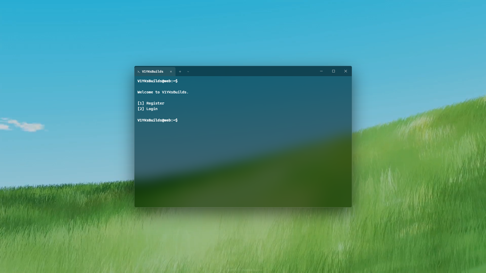

# V1YKsBuilds

A terminal-style website with **real authentication**. Visitors register and log in by typing in a frosted-glass terminal window floating over an animated gradient, then see a members list ("contracts") loaded from a Postgres database.

**Stack:** Next.js · React · TypeScript · Tailwind CSS · Supabase Auth + Postgres (with Row Level Security) · Vercel

<!-- Add a screenshot: save it as docs/screenshot.png, then uncomment the next line -->
<!--  -->

## Features

- Interactive terminal UI: type `1` to register, `2` to log in
- Registration with email, username and masked password (confirm step included)
- Login through Supabase Auth, with the session restored on reload
- Contracts list read from Postgres; Row Level Security decides who can read what
- Commands after login: `contracts`, `help`, `clear`, `logout`
- Mobile friendly (adapts to the on-screen keyboard)
- No passwords stored by this app; Supabase Auth handles them

## Quick start

### 1. Prerequisites

- [Node.js](https://nodejs.org) 20.9 or newer
- [Git](https://git-scm.com)
- A free [Supabase](https://supabase.com) account

### 2. Get the code

```bash
git clone https://github.com/AaravKr03/LogPage.git
cd LogPage
npm install
```

### 3. Create a Supabase project

Create a new project at [supabase.com/dashboard](https://supabase.com/dashboard) and wait for it to finish setting up.

### 4. Create the database tables

Open **SQL Editor → New query**, paste the **entire contents** of [`supabase/setup.sql`](supabase/setup.sql) (the SQL itself, not the file name) and click **Run**. You should see "Success. No rows returned".

### 5. Add your keys

Copy the example env file:

```bash
# macOS / Linux
cp .env.example .env.local
# Windows (Command Prompt)
copy .env.example .env.local
```

Open `.env.local` and fill in two values from your Supabase dashboard (the **Connect** button, or **Project Settings → API Keys**):

```
NEXT_PUBLIC_SUPABASE_URL=https://YOUR-PROJECT-REF.supabase.co
NEXT_PUBLIC_SUPABASE_PUBLISHABLE_KEY=your-publishable-key
```

- The URL must end at `.supabase.co` (no `/rest/v1`, no trailing slash).
- Use the **publishable** key (starts with `sb_publishable_`) or the legacy **anon** key. **Never** use the `service_role` / secret key.
- The file must be named exactly `.env.local`.

### 6. Run it

```bash
npm run dev
```

Open <http://localhost:3000>. Restart the server whenever you change `.env.local`.

### 7. Try it

1. Type `1` and press Enter to register.
2. Supabase emails you a confirmation link by default. Click it. For quick testing you can turn off **Confirm email** in your project's Authentication settings.
3. Add yourself to the contracts list: SQL Editor, then run (use your own username):
   ```sql
   insert into public.contracts (username) values ('your_username');
   ```
4. Refresh, type `2`, log in, and you'll see the contracts screen.

## Deploy to Vercel

1. Push your copy to GitHub.
2. Go to [vercel.com/new](https://vercel.com/new) and import the repository (defaults are fine).
3. Before deploying, add the same two variables under **Environment Variables**:
   `NEXT_PUBLIC_SUPABASE_URL` and `NEXT_PUBLIC_SUPABASE_PUBLISHABLE_KEY`.
4. Deploy. If you add or change variables later, **redeploy**: `NEXT_PUBLIC_` values are baked in at build time.

## Terminal commands

| Where | Input | What it does |
| --- | --- | --- |
| Start screen | `1` / `2` | Register / Log in |
| After login | `contracts` | Show the contracts list |
| After login | `help` | List commands |
| After login | `clear` | Clear the screen |
| After login | `logout` | Sign out |

## Customize

- **Background:** replace `public/bg.mp4` (a seamless loop works best) and `public/bg-poster.jpg` (shown while loading or with reduced motion).
- **Window tint and blur:** edit `bg-black/50` and `backdrop-blur-xl` in `components/RetroWindow.tsx`.
- **Text and flow:** the whole terminal is in `components/Terminal.tsx`.

## Project structure

```
app/                  Next.js app (layout, page, global styles)
components/
  Terminal.tsx        Terminal logic: register, login, contracts, commands
  RetroWindow.tsx     Window chrome (tab bar, blur, layout)
  BackgroundVideo.tsx Looping background video
  ViewportFit.tsx     Keeps the window above the mobile keyboard
lib/supabase.ts       Supabase client (created on first use)
supabase/setup.sql    Database setup: tables, RLS policies, trigger
public/               Background video and poster
```

## Security notes

- Only the **publishable** key ships to the browser; Row Level Security is what protects the data. Check the policies in `supabase/setup.sql` before you change anything.
- **Never commit `.env.local`** (it is in `.gitignore`) and never put a `service_role` / secret key in this project.
- Contracts are read-only from the app. Add or remove entries in the Supabase dashboard.
- If you ever commit a real secret by accident, rotate it in Supabase immediately.

## Troubleshooting

| Message or symptom | Fix |
| --- | --- |
| `Supabase is not configured.` | `.env.local` is missing, misnamed, or the server wasn't restarted. On Vercel: add both variables and redeploy. |
| `Invalid path specified in request URL` | `NEXT_PUBLIC_SUPABASE_URL` has extra path or a trailing slash. It must end at `.supabase.co`. |
| `Could not create account. That username may already be taken.` | Pick another username (3-20 chars: a-z, 0-9, `_`). |
| `Email not confirmed.` | Click the link in your confirmation email, or turn off email confirmation for testing. |
| `Invalid credentials.` | Wrong email or password. |
| `Could not load contracts.` | `supabase/setup.sql` hasn't been run, or it failed part-way. Run it again on a fresh project. |
| `Module not found: @supabase/supabase-js` | Run `npm install`. |

## Contributing

Issues and pull requests are welcome. Run `npm run build` before opening a PR, and never include secrets in commits or screenshots.

## License

Code: [MIT](LICENSE). Media files in `public/` (the background video and poster) are placeholders and are **not** covered by the MIT license; use your own. The Cascadia Mono font is bundled through `@fontsource/cascadia-mono` under the SIL Open Font License.
